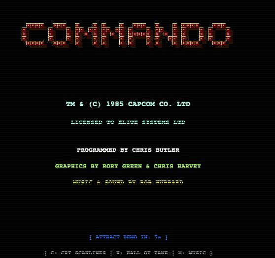

# PROJEK RETRORECON: COMMODORE 64 COMMANDO (1985)
**'n Outentieke, Bewysgedrewe Python-Rekonstruksie**

> **Metodologie:** RETRORECON Meesterprompt (D00 v1.3 & D01 v1.1-RC)  
> **Oorspronklike Spel:** *Commando* (Capcom / Elite Systems, 1985)  
> **Oorspronklike Skeppers:** Chris Butler (Programmering), Rory Green & Chris Harvey (Grafika), Rob Hubbard (Musiek & SID Klankeffekte)  
> **Taal & Platform:** Python 3.12 (Suiwer Objekgeoriënteerd, Tkinter, Geen Pip-afhanklikhede)

---

## 1. OORSIG & GESKIEDENIS

In 1985 het Capcom die arkadespeletjie *Commando* vrygestel. Elite Systems het die tuisrekenaarregte verkry en die legendariese programmeerder **Chris Butler** opdrag gegee om die Commodore 64-weergawe te skep. Binne 'n paar maande het Butler, saam met kunstenaars **Rory Green & Chris Harvey** en musiekpionier **Rob Hubbard**, een van die mees ikoniese en tegnies indrukwekkendste speletjies in die geskiedenis van die C64 geskep.

Hierdie projek is 'n getroue, bewysgedrewe rekonstruksie van daardie oorspronklike C64-meesterstuk, direk ontleed uit die amptelike skyfbeeld (`Commando.d64`) en gemodelleer in suiwer, moderne Python sonder 'n generiese emulator.



---

## 2. INGENIEURSBAGINSELS & ARGITEKTUUR

* **Geen Eksterne Pip-pakkette:** Die hele speletjie loop op standaard Python 3.12 (met `tkinter` vir grafika en native klank via `wave`/`afplay`).
* **50 Hz PAL Tydreëling:** Vaste 20 ms tydstap per raam vir getroue C64 PAL-spoed.
* **Chris Butler se 8-Rigting Hoekkodes:** Rigtingkyk en beweging gebruik die presiese diskrete hoekkodes uit Butler se masjienkode (`0=UP, 2=UP_RIGHT, 4=RIGHT, 6=DOWN_RIGHT, 8=DOWN, 10=DOWN_LEFT, 12=LEFT, 14=UP_LEFT`).
* **Suiwer SID-Klanksintese:** Al 9 musieksnitte en klankeffekte word dinamies wiskundig gesintetiseer as 16-bis WAV-strome met SID-driehoek-, pulswydte-modulasie- en gefiltreerde ruisgolwe.
* **Test-Driven Development (TDD):** 19 omvattende eenheidstoetse in `./tests/test_commando.py` wat alle bewegings, botsings, AI, speloorgange en lêerstoorders verifieer in < 0.005 sekondes.

---

## 3. SPELKENMERKE

### 3.1 Introskerm & Attract Demo-Modus
* **Reuse C64 COMMANDO-logo:** 3D-reliëf militêre stensil-blokletters met skaduwees en geel randglanse.
* **Amptelike Krediete:** Capcom / Elite Systems, Chris Butler, Rory Green, Chris Harvey en Rob Hubbard.
* **Attract Demo:** As die speler nie dadelik begin nie, skakel die spel na 8 sekondes outomaties oor na 'n AI-gedrewe demo-modus waar Super Joe self deur Vlak 1 vorder, hindernisse vermy, vyande afmaai en granate gooi!
* **Onmiddellike Oorskakeling:** Druk enige tyd `Space` of `Enter` om die regte spelronde te begin.

### 3.2 Drie Volledige Vlakke
1. **Area 1: The Outpost (Die Buitepos):**
   * Oerwoudbome langs die flanke, sandsakbunkers, loopgrawe en versperrings.
   * Militêre vragmotor wat ekstra vyandelike soldate ontplooi.
   * Gyselaar (POW) bewaak deur 'n vyand.
   * Vestinghek 1 met 2 Vestingwagte.
2. **Area 2: River Crossing (Die Rivier & Hangbrug):**
   * Vloeiende blou rivier wat dwars oor die slagveld sny.
   * Houthangbrug met deurgangbeheer en sandsak-skuts aan die oorkant.
   * Gyselaars voor en na die rivier.
   * Granaatkratte en Vestinghek 2.
3. **Area 3: Desert Fortress (Woestynvesting & Finale Hoofkwartier):**
   * Woestyngrond met sand- en rotskleure (`#C29B38` / `#D2AB48`).
   * Swaar spervuur-loopgrawe, bunkers, troepevragmotor en meervoudige gyselaars.
   * Finale Vestinghek 3 met 4 elite Vestingwagte.
   * **Oorwinningskerm:** Triomffanfare, `MISSION ACCOMPLISHED! SUPER JOE SAVED THE DAY!` en +25,000 bonus.

### 3.3 Taktiese Vyand-AI
* **Patrolliesoldate:** Gewone infanterie wat opruk en vuur.
* **Hurkende Skuts (`CROUCHING_GUNNER`):** Skuil agter sandsakke waar hulle heeltemal onkwesbaar is teen koeëls, en loer slegs uit wanneer hulle opstaan om te vuur.
* **Vinnige Offisiere (`OFFICER_RUNNER`):** Beweeg teen hoë spoed vanaf die sye in om die speler te flankeer.
* **Hekwagte:** Verdedig die hekke van die vestings en moet almal uitgeskakel word voor die hek oopgaan.

### 3.4 Krygsgevangenes (POWs) & Voorraadkratte
* **POWs:** Gevange geallieerde soldate wat vasgebind sit of bewaak word. Skiet die wag uit om die gyselaar te bevry. Hy hardloop jubelend vry na onder ("THANKS!"), 'n SID-chime speel en jy verdien **+1,000 bonuspunte**! Friendly fire geld: as jou koeël hom tref, sneuwel hy sonder punte.
* **Granaatkratte ("G"):** Tel houtkiste op die grond op vir **+3 granate** en **+500 punte**.

### 3.5 C64 Hall of Fame & Naam-invoer
* As jy 'n toptelling behaal (by Game Over of Oorwinning), vertoon die spel 'n naam-invoerskerm waar jy jou naam / voorletters (tot 8 letters) met die sleutelbord kan intik.
* Tellings word outomaties op skyf gestoor in `highscores.json`.
* Druk enige tyd **H** om die Hall of Fame oop te maak, vergesel van Rob Hubbard se spesifieke High Score wysie.

### 3.6 Opsionele CRT-skandeerlyne (Scanlines)
* Druk **C** om subtiele horisontale CRT-skandeerlyne aan of af te skakel vir daardie outentieke Commodore 1084S-monitorgevoel.
* Konfigurasie word outomaties bewaar in `config.json`.

---

## 4. SLEUTELBORDKONTROLES

| Sleutel | Funksie |
|---|---|
| **Pyltjiesleutels** / **W, A, S, D** | Beweeg Super Joe in 8 rigtings |
| **Spasiebalk** / **Enter** | Skiet masjiengeweer / Begin spel vanaf Titelskerm / Bevestig naam |
| **Z** / **G** / **Shift** | Gooi handgranaat (paraboliese boog oor hindernisse) |
| **C** | Skakel CRT-skandeerlyne aan / af |
| **M** | Skakel Rob Hubbard SID-agtergrondmusiek aan / af |
| **H** | Wys / verberg die C64 Hall of Fame hoëtellingstabel |
| **R** | Herbegin spelronde |
| **Q** / **Esc** | Verlaat die speletjie |

---

## 5. INSTALLASIE & TOETSE

### 5.1 Vereistes en aflaai

Gebruik Python 3.12 met Tkinter. Klankweergawe gebruik macOS se `afplay`.
Die projek word met behulp van ChatGPT ontwikkel.

```bash
git clone https://github.com/pappavis/commando_ai.git
cd commando_ai
```

### 5.2 Hardloop die speletjie

```bash
python3 src/commando.py
```

Die ingeslote PNG-intro werk sonder ekstra pip-pakkette. Pillow is slegs
opsioneel vir die JPG-na-PNG-terugval indien die PNG ontbreek.
Instellings en hoëtellings word plaaslik geskep en nie in Git gestoor nie.

### 5.3 Hardloop die bestaande eenheidstoetse

Vanaf die projek se hoofmap:

```bash
python3 -m unittest discover -s tests
```

## 6. LÊERSTRUKTUUR

```text
commando_ai/
├── README.md
├── docs/                    # RETRORECON-metodologie en spesifikasies
├── src/
│   ├── commando.py          # Speletjie, enjin, AI, vlakke en Tkinter GUI
│   ├── sound_effects.py     # Klank- en musieksintese
│   ├── intro.png           # Introskerm
│   ├── Commando.d64        # C64-ontledingsmateriaal
│   ├── extracted_d64/      # Onttrekte PRG-lêers
│   └── *.py               # Ontledingshulpmiddels
└── tests/
    └── test_commando.py    # Bestaande eenheidstoetse
```

---
*Projek RETRORECON — Bewysgedrewe C64 Erfenisbewaring in Python.*

Deur: Michiel Erasmus met Codex

